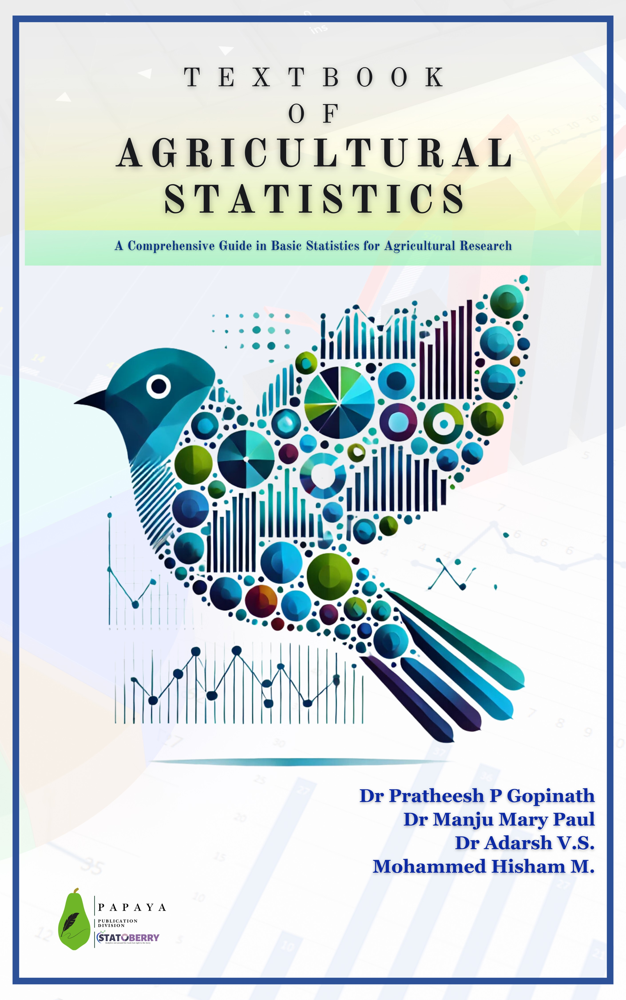

Free online reading, wherever you study. Choose a book to open its full chapter list. The collection currently includes statistics and R; other subjects will be added as new resources are contributed.

```{=html}
<div class="library-tools" hidden>
<label for="book-search">Find a book</label>
<input id="book-search" type="search" placeholder="Try R, statistics or STAT 3202" autocomplete="off" aria-controls="book-list">
<p id="book-count" role="status" aria-live="polite">2 books available</p>
</div>
<div class="book-grid" id="book-list">
<article class="book-card" data-search="agricultural statistics stat 3202 undergraduate experiments probability regression">
<a class="cover-link" href="agstat-textbook.html" aria-label="Read Textbook of Agricultural Statistics"></a>
<div class="book-body"><span class="tag">FOUNDATIONS · STAT 3202</span><h2><a href="agstat-textbook.html">Textbook of Agricultural Statistics</a></h2><p>Learn the ideas behind agricultural research through worked examples, statistical methods and experimental design.</p><p class="book-meta">Undergraduate · Online textbook</p><p class="book-usage" data-book-usage="agricultural-statistics">Loading usage…</p><a class="button primary" href="agstat-textbook.html">Start reading <span aria-hidden="true">→</span></a></div>
</article>
<article class="book-card" data-search="r programming agricultural data analysis stat 531 practical coding visualization regression anova">
<a class="cover-link" href="r-textbook.html" aria-label="Read R Programming for Agricultural Data Analysis"></a>
<div class="book-body"><span class="tag">NEW · R PROGRAMMING</span><h2><a href="r-textbook.html">R Programming for Agricultural Data Analysis</a></h2><p>From your first R commands to cleaning, visualization, statistical analysis and reproducible reports.</p><p class="book-meta">14 browser R laboratories · Practical companion</p><p class="book-usage" data-book-usage="r-agricultural-data">Loading usage…</p><a class="button primary" href="r-textbook.html">Start reading <span aria-hidden="true">→</span></a></div>
</article>
</div>
<p class="usage-note">Usage shown for the last 30 days. An engaged read means at least 30 estimated active seconds.</p>
<p id="no-books" hidden>No matching books. Try “R” or “statistics”, or clear your search.</p>
```

::: {.help-strip}
**Reading on your phone?** Open a book, use its chapter menu and bookmark the chapter you are studying. [More reading tips](student-guide.qmd).
:::


