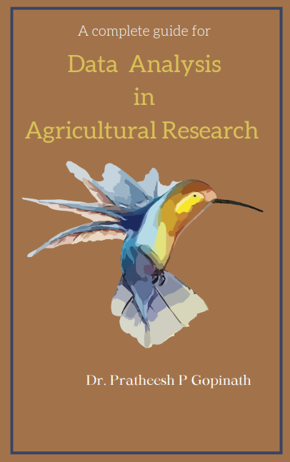
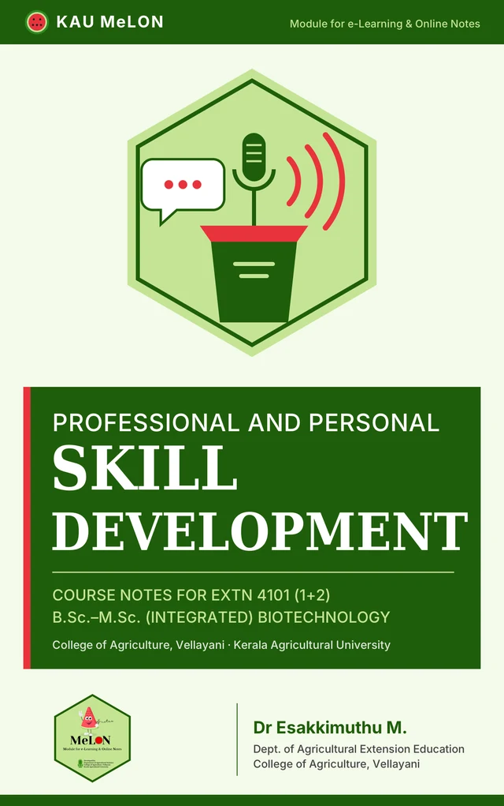
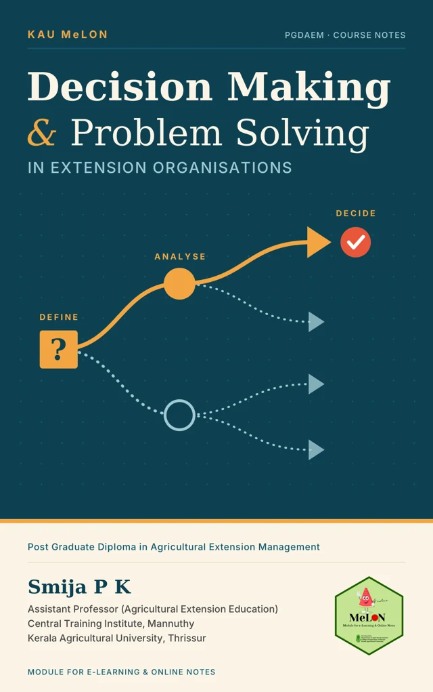
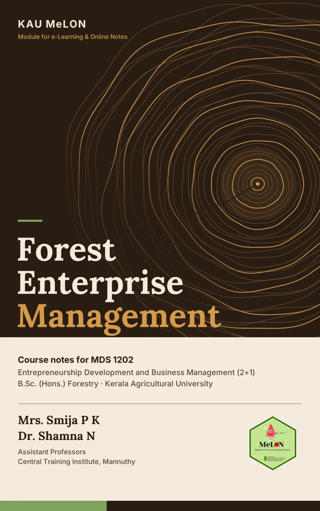

---

title: "Learn a little. Grow a lot."

pagetitle: "Me-LON | Your agricultural learning library"

title-block-banner: false

page-layout: full

---


```{=html}

<section class="hero" aria-labelledby="hero-heading">

<div><p class="eyebrow">KERALA AGRICULTURAL UNIVERSITY · Me-LON</p>

<h1 id="hero-heading">Your subjects.<br>Your learning space.</h1>

<p class="hero-copy">Me-LON brings lecture notes, textbooks and practical resources together for students of Kerala Agricultural University. Learn across subjects, wherever you are.</p>

<div class="actions"><a class="button primary" href="bookshelfug.html">Explore the library <span aria-hidden="true">↗</span></a><a class="button secondary" href="student-guide.html">New here? Start here</a></div>

<p class="small-note">For UG, PG and PhD students · Phone, tablet or laptop</p></div>

<div class="hero-art" aria-hidden="true"><span class="art-label">ROOM FOR EVERY SUBJECT</span><div class="growth"><i></i><i></i><i></i><i></i><i></i><i></i></div><div class="art-bottom"><span>Read. Explore. Grow.</span><strong>Me-LON / KAU</strong></div></div>

</section>

<section class="section-block" aria-labelledby="choose-heading">

<div class="section-heading"><div><p class="eyebrow">EXPLORE THE COLLECTION</p><h2 id="choose-heading">On the shelves now</h2></div><a href="bookshelfug.html">View all books →</a></div>

<p>Explore statistics, R programming, and extension and professional skills. Discover more subjects as teachers share new resources.</p>

<div class="cover-shelf">

<a class="shelf-book" href="agstat-textbook.html">
<div class="book-badges"><span class="category-tag">Ag. Statistics</span></div>


<span class="course-label">STAT 3202</span><h3>Textbook of Agricultural Statistics</h3><p class="book-usage" data-book-usage="agricultural-statistics">Loading usage…</p><span class="card-link">Tap to read →</span>

</a>

<a class="shelf-book" href="r-textbook.html">
<div class="book-badges"><span class="category-tag">Ag. Statistics</span><span class="new-badge" data-published="2026-10-20" hidden><span aria-hidden="true">✦</span> New</span></div>



<span class="course-label">R Programming</span><h3>R Programming for Agricultural Data Analysis</h3><p class="book-usage" data-book-usage="r-agricultural-data">Loading usage…</p><span class="card-link">Tap to read →</span>

</a>

<a class="shelf-book" href="extn4101-textbook.html">
<div class="book-badges"><span class="category-tag category-extension">Extension</span><span class="new-badge" data-published="2026-10-21" hidden><span aria-hidden="true">✦</span> New</span></div><span class="course-label">EXTN 4101 (1+2)</span><h3>Professional and Personal Skill Development</h3><p class="book-usage" data-book-usage="professional-personal-skills">Loading usage…</p><span class="card-link">Tap to read →</span></a>
<a class="shelf-book" href="pgdaem-textbook.html"><div class="book-badges"><span class="category-tag category-extension">Extension</span><span class="new-badge" data-published="2026-10-21" hidden><span aria-hidden="true">✦</span> New</span></div><span class="course-label">PGDAEM</span><h3>Decision Making and Problem Solving in Extension Organisations</h3><p class="book-usage" data-book-usage="pgdaem-decision-making">Loading usage…</p><span class="card-link">Tap to read →</span></a>
<a class="shelf-book" href="mds1202-textbook.html"><div class="book-badges"><span class="category-tag category-extension">Extension</span><span class="new-badge" data-published="2026-10-26" hidden><span aria-hidden="true">✦</span> New</span></div><span class="course-label">MDS 1202 (2+1)</span><h3>Forest Enterprise Management</h3><p class="book-usage" data-book-usage="forest-enterprise-management">Loading usage…</p><span class="card-link">Tap to read →</span></a>
</div><p class="library-meta" id="usage-heading"><a class="metrics-button" href="usage.html#usage-heading" data-public-usage><i class="bi bi-speedometer2" aria-hidden="true"></i><span>Metrics</span><span class="metrics-mini"><b data-usage="opens">…</b> opens <span aria-hidden="true">·</span> <b data-usage="engaged">…</b> reads</span><span aria-hidden="true">↗</span></a></p></section>

<section class="section-block" aria-labelledby="learning-heading">

<p class="eyebrow">MORE WAYS TO LEARN</p><h2 id="learning-heading">Your online classroom</h2>

<a class="mooc-card mooc-link" href="stat-maash.html" aria-label="Learn about STAT MAASH MOOC"><div><span class="tag">MOOC</span><h3>STAT MAASH</h3><p>Mentor AI for Academic Success and Help. A guided learning space with interactive lessons, R practice and self-assessment.</p><span class="card-link">Explore STAT MAASH →</span></div></a>

</section>

<section class="help-strip"><div><p class="eyebrow">FOR STUDENTS</p><h2>Your course material, wherever you study.</h2><p>Read online books, revisit lecture notes and use practical resources shared by your teachers. For passcode-protected course notes, use the link and passcode your teacher provides.</p></div><a class="button secondary" href="student-guide.html">Student guide →</a></section>

<section class="help-strip"><div><p class="eyebrow">FOR TEACHERS · ALL SUBJECTS</p><h2>Help the Me-LON library grow.</h2><p>Share your lecture notes or educational content with the department. We can help turn your Word documents into online reading resources for students.</p></div><a class="button secondary" href="about.html#contact">Contribute material →</a></section>

```


::: {.department-note}

Made for curious minds at **Kerala Agricultural University**. Developed by **[Dr. Pratheesh P. Gopinath](https://agstatistics.com/faculty.html#sub-lt-dr-pratheesh-p-gopinath)**. Contact: [pratheesh.pg@kau.in](mailto:pratheesh.pg@kau.in). Maintained by the [Department of Agricultural Statistics](https://agstatistics.com), College of Agriculture, Vellayani. [Meet Me-LON](about.qmd).

:::


