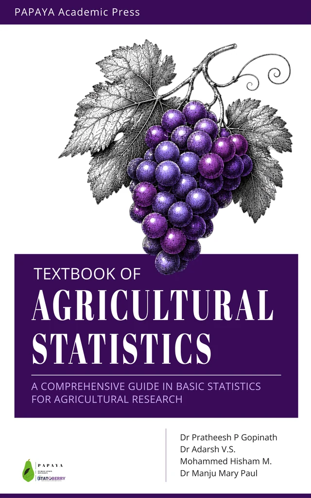

```{=html}
<link rel="stylesheet" href="revision/assets/hub.css">
<section class="rv-book" aria-labelledby="rv-agstat">
  <div class="rv-book-head">
    
    <div><span class="course-label">STAT 3202</span><h2 id="rv-agstat">Textbook of Agricultural Statistics</h2><p class="rv-count" data-book="agstat">All 24 chapters ready</p></div>
  </div>
  <ol class="rv-list" data-book="agstat">
    <li class="rv-ch ready"><a href="revision/agstat/01-basics-of-statistics.html"><span class="rv-n">01</span><span class="rv-t">Basics of statistics</span><span class="rv-go">Read · PDF →</span></a></li>
    <li class="rv-ch ready"><a href="revision/agstat/02-official-agricultural-statistics.html"><span class="rv-n">02</span><span class="rv-t">Official agricultural statistics</span><span class="rv-go">Read · PDF →</span></a></li>
    <li class="rv-ch ready"><a href="revision/agstat/03-graphical-representation.html"><span class="rv-n">03</span><span class="rv-t">Graphical representation</span><span class="rv-go">Read · PDF →</span></a></li>
    <li class="rv-ch ready"><a href="revision/agstat/04-central-tendency-1.html"><span class="rv-n">04</span><span class="rv-t">Central tendency I</span><span class="rv-go">Read · PDF →</span></a></li>
    <li class="rv-ch ready"><a href="revision/agstat/05-central-tendency-2.html"><span class="rv-n">05</span><span class="rv-t">Central tendency II</span><span class="rv-go">Read · PDF →</span></a></li>
    <li class="rv-ch ready"><a href="revision/agstat/06-measures-of-dispersion.html"><span class="rv-n">06</span><span class="rv-t">Measures of dispersion</span><span class="rv-go">Read · PDF →</span></a></li>
    <li class="rv-ch ready"><a href="revision/agstat/07-skewness-and-kurtosis.html"><span class="rv-n">07</span><span class="rv-t">Skewness and kurtosis</span><span class="rv-go">Read · PDF →</span></a></li>
    <li class="rv-ch ready"><a href="revision/agstat/08-measures-of-association.html"><span class="rv-n">08</span><span class="rv-t">Measures of association</span><span class="rv-go">Read · PDF →</span></a></li>
    <li class="rv-ch ready"><a href="revision/agstat/09-regression-analysis.html"><span class="rv-n">09</span><span class="rv-t">Regression analysis</span><span class="rv-go">Read · PDF →</span></a></li>
    <li class="rv-ch ready"><a href="revision/agstat/10-probability.html"><span class="rv-n">10</span><span class="rv-t">Probability</span><span class="rv-go">Read · PDF →</span></a></li>
    <li class="rv-ch ready"><a href="revision/agstat/11-probability-distributions.html"><span class="rv-n">11</span><span class="rv-t">Probability distributions</span><span class="rv-go">Read · PDF →</span></a></li>
    <li class="rv-ch ready"><a href="revision/agstat/12-sample-survey.html"><span class="rv-n">12</span><span class="rv-t">Sample survey</span><span class="rv-go">Read · PDF →</span></a></li>
    <li class="rv-ch ready"><a href="revision/agstat/13-hypothesis-testing.html"><span class="rv-n">13</span><span class="rv-t">Hypothesis testing</span><span class="rv-go">Read · PDF →</span></a></li>
    <li class="rv-ch ready"><a href="revision/agstat/14-large-sample-test.html"><span class="rv-n">14</span><span class="rv-t">Large sample test</span><span class="rv-go">Read · PDF →</span></a></li>
    <li class="rv-ch ready"><a href="revision/agstat/15-small-sample-tests.html"><span class="rv-n">15</span><span class="rv-t">Small sample tests</span><span class="rv-go">Read · PDF →</span></a></li>
    <li class="rv-ch ready"><a href="revision/agstat/16-design-of-experiments.html"><span class="rv-n">16</span><span class="rv-t">Design of experiments</span><span class="rv-go">Read · PDF →</span></a></li>
    <li class="rv-ch ready"><a href="revision/agstat/17-uniformity-trials.html"><span class="rv-n">17</span><span class="rv-t">Uniformity trials</span><span class="rv-go">Read · PDF →</span></a></li>
    <li class="rv-ch ready"><a href="revision/agstat/18-analysis-of-variance.html"><span class="rv-n">18</span><span class="rv-t">Analysis of variance</span><span class="rv-go">Read · PDF →</span></a></li>
    <li class="rv-ch ready"><a href="revision/agstat/19-multiple-comparison-tests.html"><span class="rv-n">19</span><span class="rv-t">Multiple comparison tests</span><span class="rv-go">Read · PDF →</span></a></li>
    <li class="rv-ch ready"><a href="revision/agstat/20-single-factor-experiments.html"><span class="rv-n">20</span><span class="rv-t">Single factor experiments</span><span class="rv-go">Read · PDF →</span></a></li>
    <li class="rv-ch ready"><a href="revision/agstat/21-factorial-experiments.html"><span class="rv-n">21</span><span class="rv-t">Factorial experiments</span><span class="rv-go">Read · PDF →</span></a></li>
    <li class="rv-ch ready"><a href="revision/agstat/22-analysis-of-covariance.html"><span class="rv-n">22</span><span class="rv-t">Analysis of covariance</span><span class="rv-go">Read · PDF →</span></a></li>
    <li class="rv-ch ready"><a href="revision/agstat/23-missing-plot-analysis.html"><span class="rv-n">23</span><span class="rv-t">Missing plot analysis</span><span class="rv-go">Read · PDF →</span></a></li>
    <li class="rv-ch ready"><a href="revision/agstat/24-data-transformation.html"><span class="rv-n">24</span><span class="rv-t">Data transformation</span><span class="rv-go">Read · PDF →</span></a></li>
  </ol>
</section>
<p class="rv-note"><b>From your textbook only.</b> These sheets use the corresponding chapter’s own Quick revision, Important formulae or Important concepts, and selected questions and answers. Where included, worked examples are taken from that same chapter. Open the chapter source link to read the full context.</p>
```
